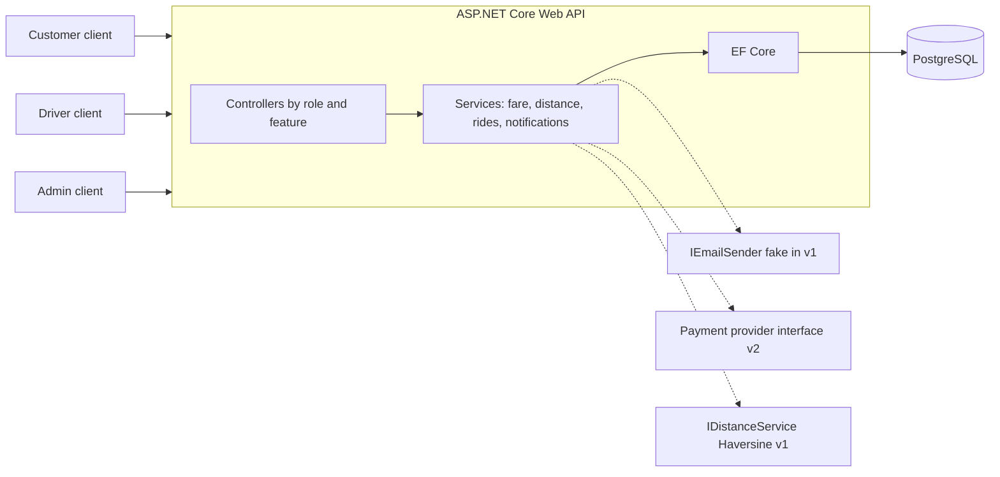
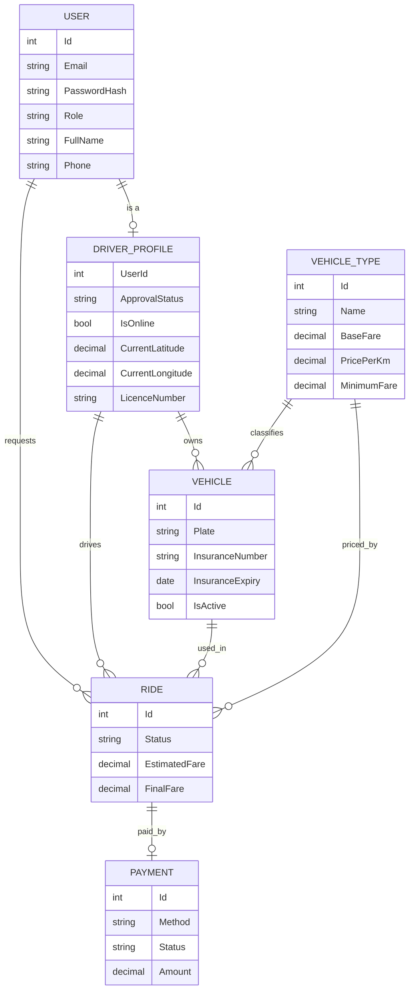

# Concept Paper

**Project:** Wni Taxi API (working title)
**Author:** Fred Wombou
**Status:** Draft v1.0
**Last updated:** October 2026

---

## 1. Summary

Wni Taxi API is a backend for a ride-hailing service. Customers request rides, approved drivers accept them, and administrators vet drivers and control pricing. It is a single ASP.NET Core Web API backed by PostgreSQL, with three roles (Customer, Driver, Admin) enforced by JWT authentication and ownership checks.

The project is also a deliberate portfolio piece: it is planned, documented, tested, containerised and deployed the way a small professional team would deliver it.

## 2. Problem

Matching a person who needs a ride with a nearby driver requires several things to work together correctly: identity and roles, driver vetting, live availability, pricing, a ride lifecycle that several people change at once, and strict privacy between users. Getting any of these wrong has real consequences, such as one customer reading another's trip, two drivers taking the same ride, or an uninsured vehicle picking up passengers.

## 3. Vision

A small, well-structured, secure API that handles the full life of a ride from request to completion, and that can later grow real-time dispatch, online payments and client apps without being rewritten.

## 4. Goals

| # | Goal | How it is measured |
|---|---|---|
| G1 | Deliver a working MVP covering register, approve, request, accept, ride, complete, pay | All version 1 features in [FEATURES.md](../FEATURES.md) ticked |
| G2 | Protect user data | Automated test proves customer A cannot read customer B's ride |
| G3 | Handle concurrency correctly | Test proves two drivers accepting one ride yields exactly one success |
| G4 | Be easy to run and review | `docker compose up` starts API and database; README works from a clean clone |
| G5 | Show professional practice | Tests, CI, documentation, decision records, version history |

## 5. Non-goals (for now)

- Mobile or web clients (version 3).
- Real payment processing and card handling (version 2 sandbox, version 3 real).
- Turn-by-turn routing and traffic-aware ETA (version 3).
- Microservices. The system starts as a modular monolith.
- Support for more than one country, currency or language.

## 6. Users and roles

| Role | Description |
|---|---|
| **Customer** | Registers with email and password, requests and tracks rides, cancels, pays |
| **Driver** | Self-registers, waits for admin approval, registers a vehicle and insurance, goes online, accepts and completes rides |
| **Admin** | Approves or rejects drivers, edits prices, sees all rides, later suspends users |

One email address maps to exactly one role.

## 7. Scope overview

| Version | Theme | Highlights |
|---|---|---|
| **1: MVP** | A complete ride works end to end | Auth, driver approval, vehicles and insurance, fare estimate, ride lifecycle, first-accept-wins, simulated payment, fake email, polling, tests, Docker, deployment |
| **2: Real-time and polish** | Feels like a live service | SignalR updates, one-driver-at-a-time offers with timeout, ratings, earnings, sandbox payments, refresh tokens, admin dashboard |
| **3: Growth** | Product and platform | Road routing, real payment providers, scheduled rides, promo codes, surge pricing, React and React Native clients, push notifications |

The detailed, ordered list is in [FEATURES.md](../FEATURES.md).

## 8. Architecture at a glance

**Technology:** C#, ASP.NET Core (controllers), EF Core with Npgsql, PostgreSQL only, JWT bearer authentication, `PasswordHasher<User>`, xUnit for tests, Docker and docker-compose, GitHub Actions.

**Key design choices** (details in [04-decisions.md](04-decisions.md)):

- Separate `User` and `DriverProfile` classes linked 1:1, not inheritance.
- Authorisation by role claims plus ownership filters in every query, not database row-level security.
- Interfaces only where a second implementation is coming (distance, email, payment).
- DTOs organised in folders by feature.
- Polling in version 1, SignalR in version 2.

## 9. Domain model (first draft)

## 10. Risks and mitigations

| Risk | Impact | Likelihood | Mitigation |
|---|---|---|---|
| Authorisation mistake exposes another user's data | High | Medium | Central "visible rides" query, ownership tests, 404 for foreign resources |
| Two drivers accept the same ride | High | Medium | Single conditional update or concurrency token; automated concurrency test |
| Scope creep delays the MVP | Medium | High | Version boundaries in the feature list; nothing from version 2 starts before version 1 ships |
| Secrets committed by accident | High | Low | User Secrets locally, environment variables when deployed, `.gitignore` first |
| Payments handled unsafely | High | Low | No card data is ever received or stored; providers handle it in later versions |
| Learning curve slows delivery | Medium | Medium | Small features with dependencies, stage-by-stage review |

## 11. Success criteria

The project is a success when:

1. Every version 1 feature is complete and the burn-down shows zero remaining points.
2. The ownership and concurrency tests pass in continuous integration.
3. A reviewer can clone the repository, run `docker compose up` and complete a ride through Scalar or Swagger using the README.
4. A public deployment is running.

## 12. Assumptions

- A single country and currency.
- Straight-line distance is acceptable for version 1 estimates.
- Payments in version 1 are simulated records only.
- Hosting uses a free or low-cost tier.

## 13. Open questions

Tracked in [04-decisions.md](04-decisions.md#open-decisions).
