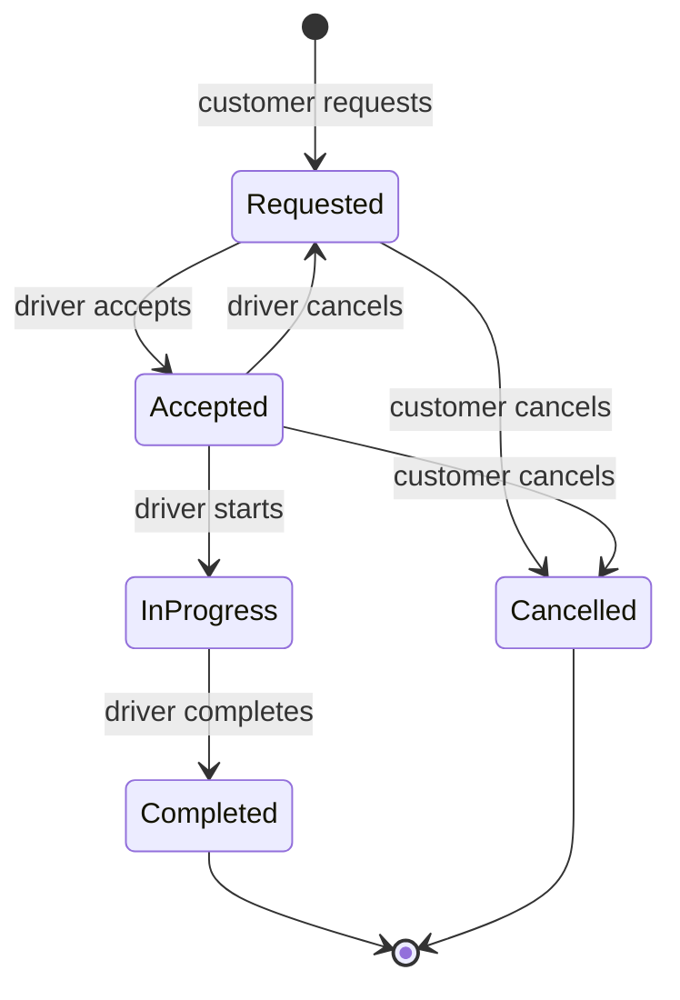

# MVP Definition

**Project:** Wni Taxi API
**Version covered:** 1 (MVP)
**Status:** Draft v1.0

---

## 1. Purpose

The MVP is the smallest system that lets a real ride happen from start to finish while staying secure. If something is not needed for that, it waits for version 2 or 3.

## 2. The MVP in one sentence

A customer can register, request a ride with a fare estimate, an approved and insured driver can accept it (first accept wins), drive it, complete it, and the payment is recorded, with every user seeing only what they should.

## 3. In scope

| Area | Included in version 1 |
|---|---|
| Accounts | Customer and driver registration, login with JWT, three roles, seeded admin, own-profile view and edit |
| Driver vetting | Driver self-registration as Pending, admin approve or reject |
| Vehicles | One vehicle per driver (editable), plate, insurance number and expiry; expired insurance blocks going online |
| Availability | Go online or offline, send location |
| Pricing | One vehicle type, fare = `max(MinimumFare, BaseFare + PricePerKm × km)`, Haversine distance, admin edits prices |
| Rides | Request, list available, accept (first wins), start, complete, cancel by customer, cancel by driver |
| Visibility | Customers see own rides, drivers see Requested plus assigned rides, admins see all |
| Payment | Simulated record on completion: in-car cash or debit machine |
| Notifications | Fake email sender that writes to the log |
| Status updates | Client polling |
| Quality | Validation, ProblemDetails errors, unit and integration tests, ownership and concurrency tests |
| Delivery | OpenAPI docs, Dockerfile, docker-compose with PostgreSQL, CI, README, deployment |

## 4. Out of scope (deferred)

| Item | Deferred to |
|---|---|
| SignalR live updates | Version 2 |
| One-at-a-time driver offers and no-driver handling | Version 2 |
| Ratings, earnings, admin dashboard | Version 2 |
| Online payments (sandbox) | Version 2 |
| Real email | Version 2 |
| Refresh tokens, suspension, rate limiting | Version 2 |
| Multiple vehicle types | Version 2 |
| Road routing and ETA, real payment providers, scheduling, promo codes, surge | Version 3 |
| Web and mobile clients, push notifications | Version 3 |

## 5. Roles and permissions

| Capability | Customer | Driver | Admin |
|---|:---:|:---:|:---:|
| Register and log in | ✔ | ✔ | seeded |
| View and edit own profile | ✔ | ✔ | ✔ |
| Fare estimate | ✔ | | |
| Request, view, cancel own ride | ✔ | | |
| Manage own vehicle | | ✔ | |
| Go online, send location | | ✔ | |
| See available rides, accept, start, complete, cancel | | ✔ | |
| Approve or reject drivers | | | ✔ |
| Edit prices | | | ✔ |
| View all rides | | | ✔ |

## 6. Ride visibility

| Role | Rides they can see |
|---|---|
| Customer | Their own rides |
| Driver | Requested rides plus rides assigned to them |
| Admin | All rides |

## 7. Ride lifecycle (proposed)

| From | To | Who | Rule |
|---|---|---|---|
| Requested | Accepted | Driver | Online, approved, no other active ride; first accept wins, the loser gets 409 |
| Requested | Cancelled | Customer | Own ride only |
| Accepted | InProgress | Assigned driver | Only that driver |
| Accepted | Requested | Assigned driver | Assignment cleared, ride becomes available again |
| Accepted | Cancelled | Customer | Own ride only |
| InProgress | Completed | Assigned driver | Final fare stored |
| InProgress | Cancelled | (not allowed in v1) | Handled manually by an admin later |

This table is a proposal; the open items are listed in [04-decisions.md](04-decisions.md#open-decisions).

## 8. Non-functional requirements

| Area | Requirement |
|---|---|
| Security | Passwords hashed; JWT signing key and connection strings outside source control; user id taken only from token claims; foreign resources return 404 |
| Data integrity | Migrations reviewed before applying; unique email; one payment per ride |
| Concurrency | Double accept resolved by a single atomic database operation |
| Reliability | Global exception handler; consistent error format |
| Maintainability | Controllers thin, logic in services, DTOs by feature folder |
| Portability | Runs identically via Docker on any machine |
| Testability | Fare and distance unit-tested; ownership, lifecycle and concurrency integration-tested |
| Privacy | No card data stored, ever |

## 9. Acceptance criteria for the MVP

The MVP is accepted when all of the following are true:

1. All **Version 1** features in [FEATURES.md](../FEATURES.md) are ticked.
2. A full ride (register, approve driver, add vehicle, go online, request, accept, start, complete, pay) can be run through the API documentation page.
3. The ownership test (customer A requests customer B's ride and gets 404) passes.
4. The double-accept test (one success, one 409) passes.
5. `docker compose up` starts the system from a clean clone.
6. CI is green and the README is complete.
7. A public deployment is live.

## 10. Estimated effort

Version 1 totals **76 size points** across **48 features** (see the summary table in [FEATURES.md](../FEATURES.md)). Progress is tracked in the burn-down log at the bottom of that file.

## 11. Dependencies and constraints

- PostgreSQL only; no other datastores in version 1.
- Single developer; learning is part of the work, so stages are reviewed before the next one begins.
- Target date for a polished, deployed portfolio project: June 2027.
